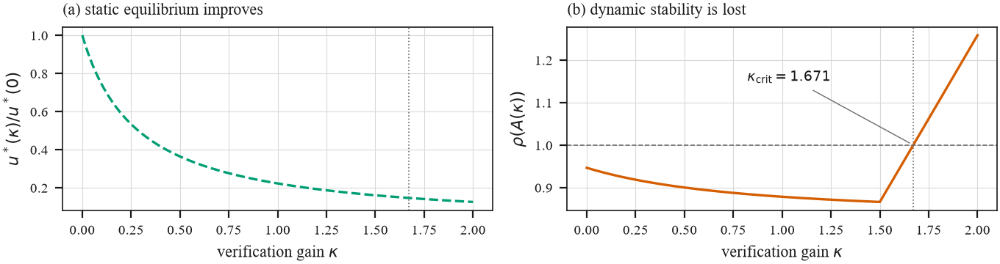
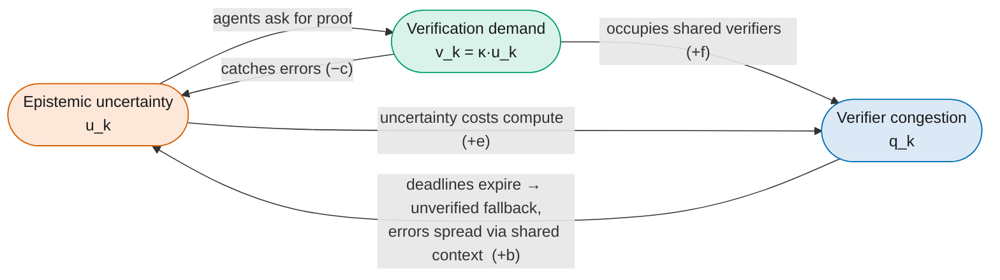
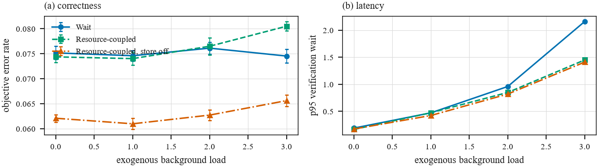
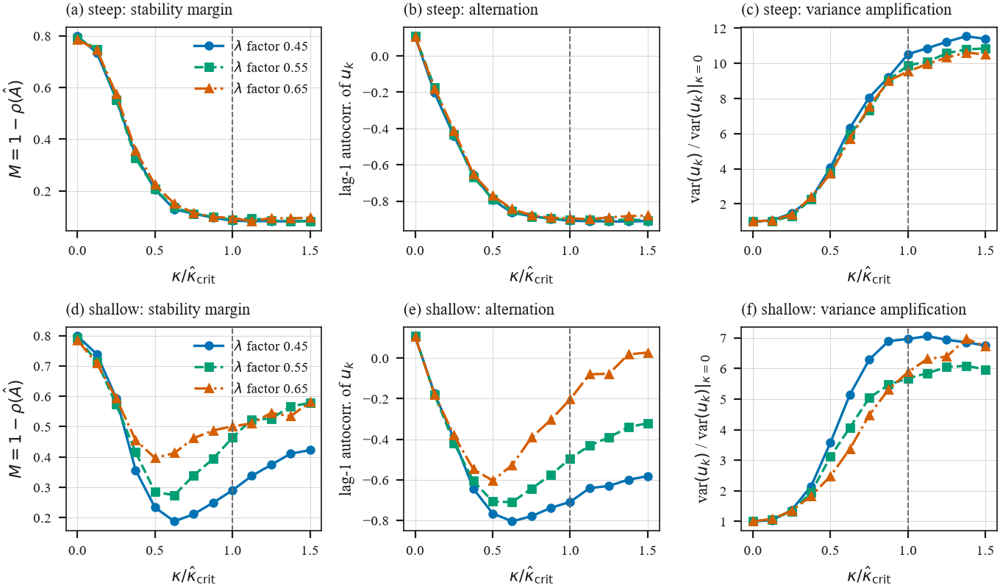
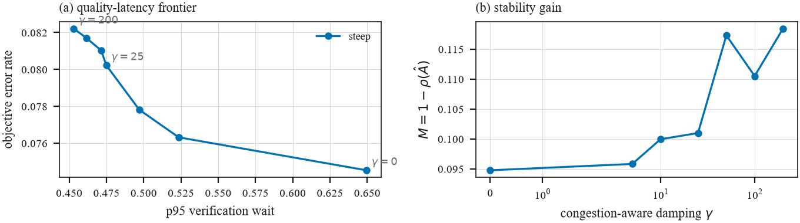

<div align="center">

# ECFI — Epistemic–Compute Feedback Instability

**When AI agents share a verifier, more checking can make the whole system less reliable.**

[](pyproject.toml)
[](LICENSE)
[](tests/)
[](#performance-and-troubleshooting)
[](frozen/prereg.md)
[](#citation)

📣 **Presented at the NANDA Workshop, IEEE TPS 2026** —
*Research Session 2: Testbeds & Network Dynamics*

[The paradox](#the-paradox-in-one-picture) ·
[Mechanism](#core-mechanism) ·
[Theory](#the-local-model-and-theorem-1) ·
[Benchmark](#the-benchmark-s1s5) ·
[Quickstart](#quickstart) ·
[Real LLM agents](#s6--real-llm-agents-a-real-shared-verifier) ·
[Cite](#citation)

</div>

---

Multi-agent LLM systems routinely verify answers they are unsure about: ask a
critic, re-run a tool, call a checker. Each check makes *that* answer better.
But the checkers are a **shared, capacity-limited service**. Push verification
hard enough and the queue fills, deadlines expire, answers slip through
unverified, wrong answers feed into other agents' context, and uncertainty rises
again — which triggers even more verification.

ECFI is that loop. This repository gives you:

- **A theory** — a two-state local model and **Theorem 1**, a closed-form upper
  bound `κ_crit` on how aggressively a system can verify before it loses
  stability.
- **A testbed** — a discrete-event simulator of agents, a verifier pool and a
  shared context store, with every coupling switchable and ground truth known.
- **A benchmark** — five pre-registered stages (S1–S5) that identify the local
  parameters, **freeze** a prediction of `κ̂_crit`, and only then sweep the
  system to see whether the prediction holds.
- **Real-agent experiments** (S6–S7) that ask the same questions of real LLM
  calls competing for a real LLM verifier.

## The paradox in one picture

<p align="center">
  
</p>

> **(a)** Turn up the verification gain `κ` and the steady-state error `u*`
> keeps falling — a static analysis says *verify more*.
> **(b)** The same system's spectral radius `ρ(A(κ))` crosses 1 at `κ_crit`:
> the equilibrium still looks better, but the loop can no longer reach it.

## Core Mechanism



1. **Uncertainty & verification.** When an agent meets uncertain evidence or
   conflicting sources, it requests proof or verification from a shared service.
2. **Congestion.** Rising verification demand saturates the shared verifiers,
   producing queueing and hitting compute capacity limits.
3. **Epistemic degradation.** As waits grow and deadlines pass, answers escape
   unchecked through unverified fallbacks. Errors propagate through shared
   context and raise *future* uncertainty across the network — closing the loop.

The point of the testbed is **not** to show that ECFI happens. It is to test
whether a `κ̂_crit` computed from *independently identified* local parameters
predicts the transition of a *nonlinear* event-driven system **out of sample**.
If the methodology fails here, where every mechanism is known and controllable,
it cannot be trusted on live infrastructure.

## The local model and Theorem 1

Around an operating point, error `u` and congestion `q` evolve as

```math
\begin{aligned}
u_{k+1} &= a\,u_k + b\,q_k - c\,v_k + \xi_k \\
q_{k+1} &= d\,q_k + e\,u_k + f\,v_k + \eta_k
\end{aligned}
\qquad v_k = \kappa\,u_k
```

| symbol | meaning |
|--------|---------|
| `a` | persistence of epistemic error |
| `b` | congestion → future epistemic degradation — **the ECFI pathway** |
| `c` | direct epistemic benefit of verification |
| `d` | persistence of congestion |
| `e` | compute induced by uncertainty |
| `f` | computational cost of verification |

**Theorem 1.** With `b, c, e, f > 0`, `d > −1` and `A(0)` Schur stable, every
stable uncertainty-proportional policy satisfies

```math
\kappa \;<\; \kappa_{\mathrm{crit}} \;=\; \frac{(1+a)(1+d) - b\,e}{c\,(1+d) + b\,f}.
```

If additionally `0 ≤ a, d < 1` and `c(1−d) ≥ bf`, the bound is exact and an
eigenvalue reaches −1 at `κ_crit`: a **flip (period-doubling) bifurcation**.
The implementation, Jury conditions and stability margin are in
[`ecfi/linear.py`](ecfi/linear.py).

## The benchmark (S1–S5)

### The order is the method

```
S1  go/no-go       is there a causal congestion → epistemic pathway (b > 0)?
S2  identification estimate a…f, compute κ̂_crit, FREEZE it
S3  sweep          only now vary κ; compare the observed transition to the freeze
S4  strategic      measure epistemic load amplification near the boundary
S5  mitigation     congestion-aware controller on the quality/latency/cost/stability frontier
```

**S3 must not be run before S2 has frozen its prediction**, and S2 must not be
re-run afterwards. `s2_identify.py` refuses to overwrite an existing freeze
without `--refreeze`, and `s3_sweep.py` refuses to start without one. The
freeze records a UTC timestamp and the git commit; commit and tag
`frozen/` before sweeping so the ordering is verifiable by someone else.

The figures below come from the reference development run
([`examples/demo-run-8seeds/`](examples/demo-run-8seeds/)). Regenerate them from
your own results with `python experiments/make_figures.py`.

### S1 — Does congestion actually hurt correctness?

<p align="center">
  
</p>

> The same background load, three ways of absorbing it. In **`WAIT`** the
> system pays in latency and correctness stays flat — queueing alone is
> harmless. In **`RESOURCE_COUPLED`** expired deadlines fall back to unverified
> answers and error climbs with load. Switching the **shared context store off**
> removes the propagated part of `b` — the internal negative control.

### S3 — Early warnings before the boundary

<p align="center">
  
</p>

> Sweeping `κ` toward the **frozen** `κ̂_crit` (dashed line) in two regimes and
> three load levels. The online stability margin `M = 1 − ρ(Â)` collapses, the
> lag-1 autocorrelation of error turns sharply negative — the period-two
> alternation a flip bifurcation predicts — and variance is amplified. These
> precursors can be read from monitoring data *before* the system tips. How far
> the observed transition lands from the frozen prediction is measured, not
> assumed: see `results/s3_endpoints.json`.

### S5 — Mitigation is a frontier, not a free lunch

<p align="center">
  
</p>

> A congestion-aware policy `v = κu / (1 + γq)` backs off when the verifier
> queue is long. Increasing `γ` cuts tail latency and buys stability margin, at
> a price in objective error. ECFI reports the whole frontier instead of a
> single "mitigation works" number.

All six figures, including the S3 prediction-ratio plot and the S4
amplification plot, are in [`figs/`](figs/).

---

## Quickstart

```bash
python3 -m venv .venv && source .venv/bin/activate
pip install -e .            # or: pip install -r requirements.txt
python3 -m pytest -q        # 32 tests, ~15 s
```

Python ≥ 3.10. Dependencies: numpy, scipy, simpy, matplotlib, sympy.
**No GPU needed** — see [Performance and troubleshooting](#performance-and-troubleshooting).

### Run everything

```bash
JOBS=16 SEEDS=20 ./run_all.sh
```

Results land in `results/*.json`, figures in `figs/*.pdf`, and the frozen
predictions in `frozen/<regime>/`. Both ship empty: a freeze is a record of
*your* prediction and must be produced on the machine that runs the study.
Reference output from the development run is in `examples/demo-run-8seeds/`,
outside every path a script reads.

The full `run_all.sh` at 20 seeds takes about **1 hour on 2 cores** and about
**10 minutes on 16 cores**. The S3 sweeps are most of it.

---

## Layout

```
examples/demo-run-8seeds/   reference output; no script reads this

ecfi/
├── linear.py      A(κ), Jury conditions, κ_crit, κ_δ, u*(κ), ρ, stability margin
├── policies.py    v = κu  and  v = κu/(1+γq), with saturation restored
├── schedules.py   piecewise-constant exogenous excitation (pulses, dither)
├── sim.py         SimPy testbed: agents, verifier pool, shared context store
├── identify.py    OLS + moving-block bootstrap + excitation diagnostics
├── detect.py      transition endpoints and H4 early-warning signals
├── ela.py         normalised epistemic load amplification 𝒜_E
└── runner.py      parallel execution and result I/O

experiments/
├── regimes.py     the two operating regimes swept end to end
├── calibrate.py   model construction only — never used to fit κ_crit
├── s1_gonogo.py … s5_mitigation.py
├── analyze_s3.py  re-derive endpoints from saved sweeps without re-running
├── s6_real_agents.py  real LLM agents + a capacity-limited verifier (needs Ollama)
├── s7_real_loop.py    closed loop on the same real components: identify, freeze, sweep
└── make_figures.py
```

## How the testbed closes the loop

`N` agents process Poisson-arriving tasks carrying objective ground truth.
Verification requests contend for `C` verifier servers (lognormal service,
FIFO). Two couplings close the loop:

**Epistemic coupling (the b-mechanism).** Wrong answers are written to a shared
context store. Each task reads `n_dep` artifacts from it with probability
`p_dep`; its error probability rises with the erroneous fraction among them.
Disabling the store sets `b ≈ 0` *by construction* — the internal negative
control.

**Resource coupling.** Each task carries a verification deadline `D`. In
`RESOURCE_COUPLED` mode an expired deadline triggers skipped verification plus a
weaker model with error multiplier `m`. In `WAIT` mode deadlines are off, so
pure queueing raises latency without touching correctness.

Verification efficacy saturates: `q_fix(v) = σ(β(v − v_half))`. A cheap check
rarely catches an error; a thorough one usually does. This is the nonlinearity
the local model of Section II approximates, and `β` is the knob that decides
whether over-correction can outrun congestion — hence the two regimes.

### Three modelling choices a reviewer will ask about

1. **The policy acts on the windowed system-level signal, not a per-task draw.**
   Section II writes `v_k = κ u_k`, where `u_k` is a system-level quantity. The
   simulator therefore has the policy respond to the monitoring signal of the
   *previous closed window*. That one-window delay is what makes the loop a
   discrete-time map capable of period doubling; with a per-task instantaneous
   response the loop self-regulates continuously and no flip exists.

2. **The monitoring signal is measured error, not pre-verification confidence.**
   Section II writes `u_k` as system-level *error*. Using the agents'
   pre-verification confidence instead adds a second window of lag and turns the
   map into a two-step one, which produces **period-three** cycles rather than
   the predicted flip. This was observed before the change and is worth stating
   in the paper: the predicted failure mode is sensitive to where monitoring
   sits relative to actuation.

3. **The policy set-point tracks the operating point.** The local model is a
   linearization *around an operating point*; the simulator tracks it with an
   EWMA whose time constant (50 windows) is far longer than the window, so it
   cannot mask window-scale dynamics but does keep nominal effort at `v̄`.
   Without it, raising `κ` moves the operating point up the saturating efficacy
   curve instead of raising the loop gain.

### The indexing convention (`lead_inputs`)

In the paper the effort indexed `k` responds to the uncertainty indexed `k` and
acts on the transition into `k+1`. In the testbed the policy observes a closed
window and applies the effort during the *next* one, so recorded `v` and `q`
sit one index ahead. `identify(..., lead_inputs=True)` (the default) restores
the paper's convention:

```
u_{k+1} ~ [u_k, q_{k+1}, v_{k+1}]
q_{k+1} ~ [q_k, u_k,     v_{k+1}]
```

With the raw indices, `c` estimates as ≈ 0 with unstable sign, because the
contemporaneous effect of effort on error has already been absorbed into `u_k`.
**Which convention a deployment needs depends on where its monitoring sits
relative to its actuation, and it must be stated rather than assumed.**

---

## S6 — real LLM agents, a real shared verifier

S1–S5 run on the simulator. `s6_real_agents.py` asks S1's question of real
model calls on one laptop: does contention for a shared verification service
damage objective correctness, and does that depend on the fallback?

```bash
ollama pull qwen2.5:3b
python experiments/s6_real_agents.py        # 5 seeds, ~2 h, writes results/s6_real_agents.json
```

It is not part of `run_all.sh`: it needs a local model server and its
wall-clock is real time, not simulated time.

**What it is, precisely.** Concurrent task agents, each holding an answer
produced by a real LLM, competing for a real LLM verifier with one slot,
against synthetic competing traffic. It is a correction-service experiment.

| piece | what it is here |
|-------|-----------------|
| model | `qwen2.5:3b` via Ollama, temperature 0, one Apple M4 |
| task, scoring | `a × b`, `a` three-digit, `b` two-digit; exact integer match against `a*b` computed in Python; a reply with no number is an error (none occurred) |
| answering | one direct call per task, done **once per seed on an idle server before any arm**; the saved answers are replayed in every arm, so answering never competes with verification |
| uncertainty `û` | `1 − exp(Σ logprob)` of the answer tokens |
| agents | one per arriving task, Poisson arrivals at 0.62/s; 100 per arm |
| verifier | a second call to the same model that recomputes the product from two partial products without seeing the agent's answer; its answer replaces the agent's. No tool, no ground truth. 0.87 s per call |
| shared service | verifier pool, `C = 1` slot, FIFO (Ollama serves one request at a time) |
| background traffic | synthetic tenants, Poisson at 0.4/s, exponential hold with mean 1.0 s; they sleep in the slot and make no model calls. Low load = none; high load = on |
| policies | `always`; `proportional` `v = κû`; `aware` `v = κû/(1+γq)`; `v` read as verification probability; `κ = 4`, `γ = 1` |
| fallback | `wait`: no deadline. `skip`: a request not started within `D = 1.5 s` is **cancelled and leaves the queue** (it never occupies capacity) and the unverified answer is returned. A verification that has started is never cut off |
| controls | tasks, arrivals and verification draws matched across arms within a seed; arm order randomised per seed; pool drained between arms |

In the results, "completed" counts completed *verifications*; every task completes in
every arm. Waits of abandoned requests enter at the time they gave up.
Latency runs from an agent's arrival to its final answer and excludes the
precomputed answering call.

**Scope.** One model, one machine, one task family, low concurrency, synthetic
competing traffic, and no shared context store — so this tests the *direct*
fallback term of `b`, not the propagated one, and makes no claim about
`κ̂_crit`.

The design and decision rule are in `frozen/prereg.md` (addendum 2). Results:
`results/s6_real_agents.json`; an earlier single-seed pilot on `qwen3:8b` is
`results/s6_pilot_qwen3_8b.json`.

## S7 — closed loop on real agents

S6 has no feedback. `s7_real_loop.py` closes the loop on the same real
components and runs identify → freeze → sweep on it, reusing `ecfi.identify`
and `ecfi.detect` unchanged. Design, gate and crossing criterion are in
`frozen/prereg.md` (addendum 3), written before the runs.

```bash
OLLAMA_HOST=127.0.0.1:11435 OLLAMA_NUM_PARALLEL=2 ollama serve &
python experiments/s7_real_loop.py identify --ollama http://127.0.0.1:11435/api/chat   # ~2 h
python experiments/s7_real_loop.py sweep    --ollama http://127.0.0.1:11435/api/chat   # ~8 h
```

| piece | what it is here |
|-------|-----------------|
| window | `W = 40` completed tasks, ≈ 16 s; 15 windows discarded |
| uncertainty / error `u_k` | fraction of the window's final results wrong against ground truth (an audit signal) |
| effect on later demand | next window, each agent verifies with probability `v = sat_[0,1](0.4 + κ(u_k − u_ref))`, `u_ref` an EWMA of `u` (20 windows) |
| epistemic coupling | half the tasks add an upstream result read from a shared store of the last 40; wrong if either part is |
| congestion `q_k` | waiting requests per verifier slot, averaged over the window's arrivals |
| adjustable gain | `κ`, fixed per run |
| service capacity | `C = 2` live verifier slots (≈ 1.9 verifications/s), fixed; arrivals 2.5 tasks/s; deadline 1.5 s, then the unverified answer stands |
| real / not real | verification calls, queueing, timeouts, store and policy are live; direct answers are replayed from a bank answered once by the same model; background tenants are synthetic |

Results: `results/s7_identify.json`, `results/s7_sweep.json`. Frozen prediction:
`frozen/real_agents/`.

---

## Defaults

| symbol | meaning | default |
|--------|---------|---------|
| `n_agents` | agents `N` | 50 |
| `n_verifiers` | verifier servers `C` | 8 |
| `load_factor` | `λ v̄ / (C μ)` at nominal effort | 0.55 |
| `p0` | nominal error probability | 0.12 |
| `p_dep`, `n_dep`, `delta_dep` | context-store coupling | 0.80, 4, 0.45 |
| `beta`, `v_half` | verification efficacy | 2.0 / 14.0, 1.30 |
| `deadline` | `D`, on waiting for a verifier | 2.0 |
| `m_fallback` | fallback error multiplier | 2.0 |
| `W` | window size, tasks | 200 (400 for identification) |
| seeds per cell | | 20 |

`W` matters more than it looks: `u_k` carries binomial noise `√(u(1−u)/W)`, and
identification is noise-limited, which is why it uses wider windows.

## Reporting obligations

Section VI names three outcomes that count as evidence *against* the framework
and must be published if observed:

1. no correctness gap between `WAIT` and `RESOURCE_COUPLED` under load;
2. a transition far from κ̂_crit despite an adequate linear fit (R² is reported
   per equation);
3. absence of the H4 precursors on approach.

Poor identification fit is a scope limit of the local model, not support for it.
`s2_identify.py` prints a warning rather than failing silently when the fit is
weak or the excitation is poor.

---

## Performance and troubleshooting

**There is no GPU path and none is needed.** A discrete-event simulation is a
single-threaded event loop; it is CPU-bound and memory-light. What buys
wall-clock is **cores**, because replications and sweep cells are independent
and are farmed out with `multiprocessing`. Every script takes `--jobs N`.

**The default is every CPU this process is allowed to use.** That is read from
`sched_getaffinity`, not `os.cpu_count()`, so a container, cgroup, `taskset` or
Slurm allocation is respected — a job pinned to 4 CPUs on a 96-core node starts
4 workers, not 96. Each worker is also pinned to a single BLAS thread, because
one thread per core *inside* every worker would be N² threads fighting over N
cores. Two cases where you may still want to pass `--jobs` explicitly:

* **SMT / hyper-threading.** The default counts *logical* CPUs. For pure-Python
  event loops the sibling threads add roughly 10–20%, not 2×, so
  `--jobs <physical cores>` gives up very little and leaves the machine usable.
* **Sharing the machine.** Nothing here yields; it will use what you give it.

### If a parallel run fails and a serial one does not

Run `python experiments/diagnose.py` first. It prints which `ecfi` is imported
from where, checksums the modules, and then runs the simulation serially, on two
workers, and at full width — so a failure is immediately attributable.

Under `spawn` (Windows, macOS) each worker is a fresh interpreter that imports
the package from scratch. A cold bytecode cache plus many simultaneous workers
can leave one of them reading a `.pyc` that another is still writing, and
executing a partially written `.pyc` produces nonsense: `SystemError: unknown
opcode`, or an `AttributeError` on a value that could not possibly hold it. The
package now compiles its own cache once, in the parent, before any worker
starts, and workers are set read-only towards it. If it still happens:

```bash
# rule out the cache entirely
PYTHONDONTWRITEBYTECODE=1 python experiments/s1_gonogo.py --jobs 8
#   PowerShell:  $env:PYTHONDONTWRITEBYTECODE=1

# confirm the simulation is healthy
python experiments/s1_gonogo.py --jobs 1 --seeds 2
```

and check that on-access virus scanning or cloud sync is not watching the
project folder — both can hand a reader a short read of a file another process
is writing.

---

## Citation

If you use ECFI, the testbed or the benchmark in your work, please cite:

```bibtex
@inproceedings{sahinoglu2026ecfi,
  title     = {Epistemic-Compute Feedback Instability in Networked {AI} Agents},
  author    = {Sahinoglu, Zafer and Kazangirler, Buse Yaren and
               Mohammed, Abdulazeez and Kazangirler, Cahit Berkay},
  booktitle = {NANDA Workshop at the IEEE International Conference on Trust,
               Privacy and Security in Intelligent Systems and Applications
               (IEEE TPS 2026)},
  year      = {2026}
}
```

GitHub's **"Cite this repository"** button (right sidebar) reads the same
entry from [`CITATION.cff`](CITATION.cff).

## License

MIT — see [LICENSE](LICENSE).
